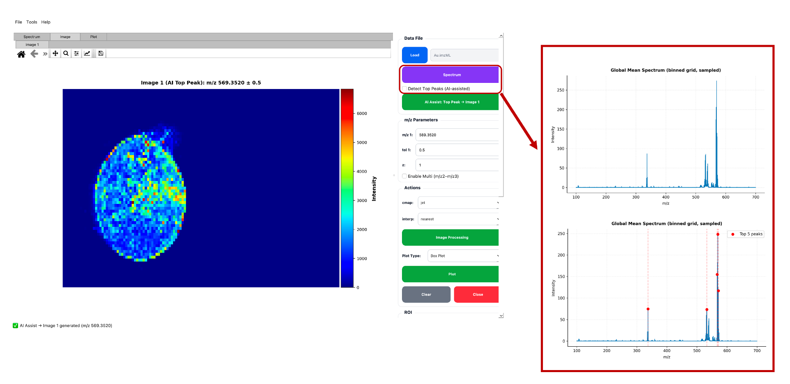
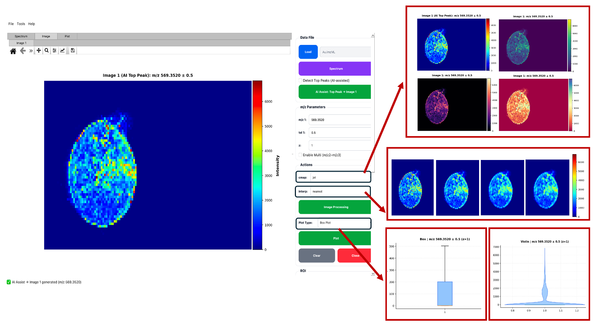
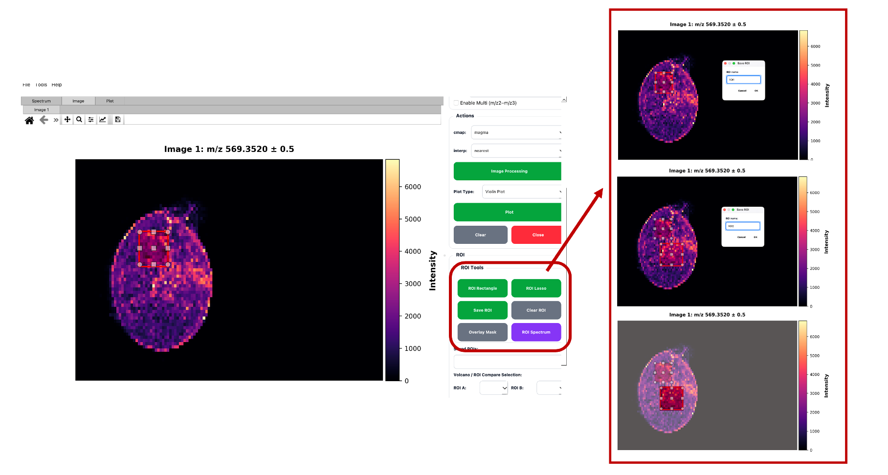
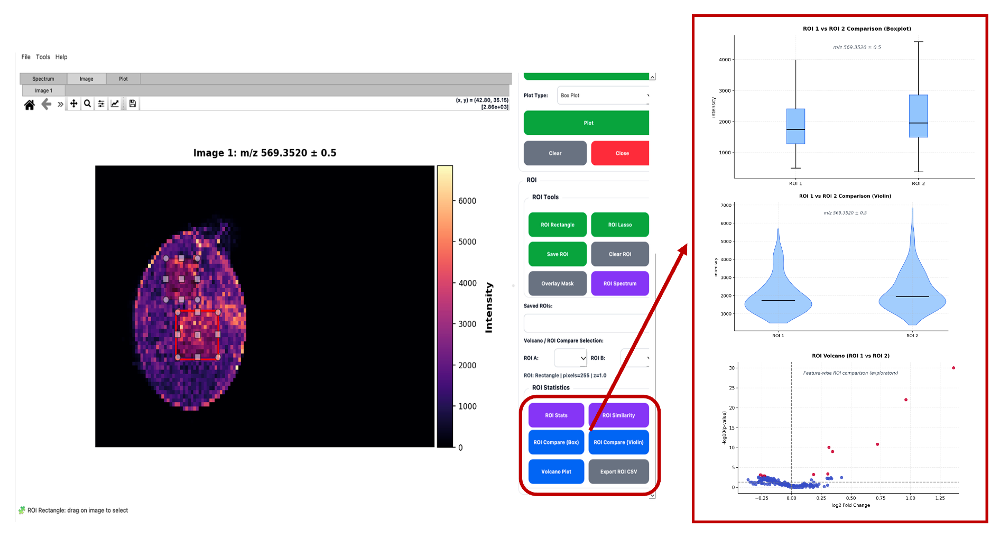

<p align="center">
  
</p>

<h2 align="center">PyMSIViz</h2>

<p align="center">
<p align="justify">An open-source graphical interface for ROI-driven statistical exploration of mass spectrometry imaging (MSI) data</p>
</p>
<p align="center">
  
  
  
  
  
</p>

## Overview

<p align="justify"><strong>PyMSIViz</strong> is an open-source, Python-based graphical user interface for interactive visualization and region-of-interest (ROI)-based statistical exploration of mass spectrometry imaging (MSI) data stored in the imzML format. It integrates <em>m/z</em> selection, rectangular and freehand ROIs, non-parametric statistical tests (including Mann–Whitney U and Kruskal–Wallis), ANOVA, Benjamini–Hochberg multiple-testing correction, Cliff's delta effect sizes, and volcano plots in a workflow that does not require programming.</p>

## Version 2.0.1

<p align="justify">This repository distributes <strong>PyMSIViz v2.0.1</strong>, including an optimized ROI-based volcano analysis workflow. Earlier internal development and validation candidate identifiers are documented separately in the development history; they should not be interpreted as distinct public releases.</p>

## Installation

<p align="justify"><strong>Requirements:</strong> Python 3.9 or later. Python package dependencies are listed in <code>requirements.txt</code>.</p>

```bash
git clone https://github.com/betulkarabudak/PyMSIViz_v2.0.1.git
cd PyMSIViz_v2.0.1
python -m pip install -r requirements.txt
python main.py
```

## Workflow

1. **Load:** Open an `.imzML` file. Its corresponding `.ibd` file must be in the same directory. Spectra are accessed on demand.
2. **Spectrum:** View a global mean or median spectrum from up to 3,000 randomly sampled pixels. Highlight the five most intense suggested peaks or generate an ion image using **Top Peak → Image 1**.
3. **Ion images:** Enter the target *m/z*, absolute tolerance (**±Da**), and z-plane. Display up to three ion images side by side. Colormap and interpolation settings affect visualization only.
4. **ROI:** Draw rectangular or freehand (lasso) ROIs, save or overlay regions, and export ROI pixel intensities to CSV.
5. **Statistics:** Compare two ROIs using intensity distributions, Mann–Whitney U tests and Cliff's delta; compare three or more ROIs using Kruskal–Wallis or ANOVA with pairwise comparisons; or generate an ROI-based volcano plot from selected high-intensity peaks. Multiple pairwise tests use Benjamini–Hochberg correction where applicable.

<p align="center"></p>

**Figure 1.** Global spectrum with five suggested high-intensity peaks.

<p align="center"></p>

**Figure 2.** Ion image display with adjustable colormap and interpolation, alongside statistical plots.

<p align="center"></p>

**Figure 3.** Interactive rectangular and lasso ROI selection.

<p align="center"></p>

**Figure 4.** ROI-based statistical comparison and volcano plot.

### Mass tolerance convention (`tol`, Da)

<p align="justify">The parameter <code>tol</code> represents the <strong>absolute half-width</strong> of the <em>m/z</em> extraction window, measured in daltons (Da). Intensities are extracted from <strong>[target m/z − tol, target m/z + tol]</strong>. For example, a target <em>m/z</em> of <strong>569.352</strong> and <code>tol = 0.5</code> correspond to <strong>568.852–569.852 m/z</strong> (full window width <strong>1.0 Da</strong>). <code>tol</code> is a parameter name, not a unit. The interface specifies tolerance in Da rather than ppm; users should select tolerances appropriate to their acquisition and mass calibration.</p>

## Interpreting ROI statistics

<p align="justify">Adjacent MSI pixels may be spatially autocorrelated. Statistical tests treating pixels as independent observations can therefore report overly optimistic significance, especially for large ROIs. Pixel-wise ROI comparisons are intended primarily for <strong>exploratory analysis</strong>, not as a substitute for independent biological replicates.</p>

- Consider effect size (including Cliff's delta), fold change, intensity distribution and spatial context alongside adjusted p-values.
- For volcano exploration, a combined threshold such as **q < 0.05** and **|log₂ fold change| > 0.5** can be used, with appropriate caution about pixel dependence.
- When spatial dependence matters, consider spatially informed sampling or analysis methods.
- Draw biological conclusions from independently replicated samples and suitable sample-level analyses.

## Testing and reproducibility

<p align="justify">The repository includes automated tests in <code>tests/</code>. Run them from the project root:</p>

```bash
python -m unittest discover -s tests -v
```

<p align="justify">Automated unit tests assess selected functions; they do <strong>not</strong> independently establish cross-platform GUI compatibility, agreement with other MSI software, or biological validity. Experimental and simulation-based numerical checks are discussed in the accompanying scientific work; their underlying validation scripts and reports are <strong>not included in this distribution</strong>.</p>

## License

<p align="justify">Released under the <strong>MIT License</strong>. See <a href="LICENSE"><code>LICENSE</code></a>.</p>
